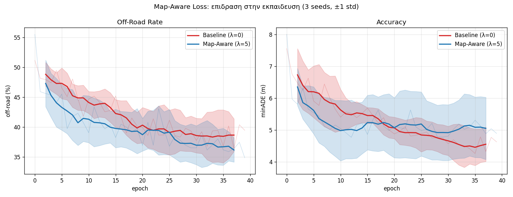
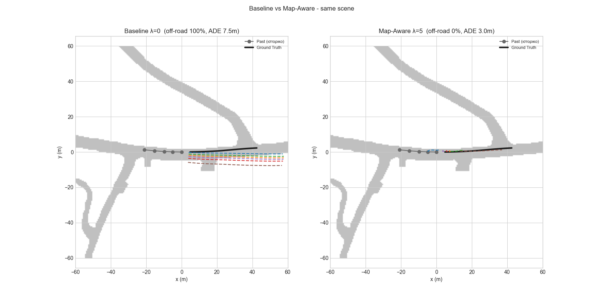

# Multimodal Trajectory Prediction for Autonomous Vehicles using Goal-Conditioned Graph Neural Networks

> MSc Thesis — MSc in Artificial Intelligence and Deep Learning, University of West Attica
> Author: Panagiotis Routsis

Predicting the future trajectories of surrounding vehicles is a critical component for the safe
operation of Autonomous Vehicles. Graph Neural Network architectures capture complex
spatio-temporal interactions well, but frequently produce **spatially inconsistent** predictions —
trajectories that cut through pedestrian islands, sidewalks and other non-drivable terrain.

This work proposes an **Encoder–Interactor–Decoder** GNN trained with a **Map-Aware Loss**: a
*differentiable* off-road penalty that constrains predictions to the HD-map drivable area.

---

## Results

Evaluated on the **held-out test split**, 5 random seeds per configuration, fixed 40-epoch budget
(no per-configuration early stopping), Welch t-tests.

| Metric | Baseline (λ=0) | **Map-Aware (λ=5)** | p-value |
|---|---|---|---|
| **Off-Road Rate** ↓ | 42.0 ± 2.2 % | **36.0 ± 1.5 %** | **0.0013** |
| **Miss Rate @2m** ↓ | 71.5 ± 6.0 % | **62.0 ± 6.7 %** | **0.046** |
| minADE ↓ | 4.61 ± 0.76 m | 4.62 ± 1.24 m | 0.979 (n.s.) |
| minFDE ↓ | 6.81 ± 1.21 m | 6.83 ± 1.58 m | 0.984 (n.s.) |

**The Map-Aware Loss reduces Off-Road Rate by 6.0 points and Miss Rate by 9.5 points, with
statistically indistinguishable displacement error.**




*Off-Road Rate and minADE per epoch, λ=0 vs λ=5 (3 seeds). Bold lines: 5-epoch moving average;
faded lines: raw values; shaded bands: ±1 std across seeds.*

---

## Architecture

```
node_features [N,5,2] --GRU--> [N,128] --GAT--> [N,128] --MDN--> K=6 trajectories per agent
```

| Stage | Component | Purpose |
|-------|-----------|---------|
| Encoder | GRU | Lightweight temporal encoding of agent history |
| Interactor | GAT (4 heads) | Cross-agent interaction modelling via attention |
| Decoder | Goal-Conditioned Laplacian MDN | Multimodal trajectory distributions |

155,302 trainable parameters.

**Design details.** The decoder predicts per-step *displacements* combined with `cumsum`, which
structurally enforces kinematic smoothness. Goals are supervised against the ground-truth endpoint
with a **winner-takes-all** objective, so the K modes specialise rather than collapse.

## The Map-Aware Loss

```
Loss = MDN_NLL + λ · OffRoad_penalty + w · Goal_loss
```

The off-road term rasterises the HD-map drivable area into an **ego-aligned** cost map and samples
predicted positions from it with `F.grid_sample`. Because this lookup is **bilinear and
differentiable**, gradients flow back into the predicted coordinates — the map actively *pulls*
trajectories onto the road rather than merely scoring them.

> A separate, **non-differentiable binary** metric (`offroad_flags`) is used for *reporting*:
> a trajectory counts as off-road if **any** of its 12 points falls outside the drivable area.
> Soft-and-differentiable for training, hard-and-interpretable for evaluation.

## Dataset

- **nuScenes v1.0-trainval** — 850 scenes → **20,549 graphs** after windowing (metadata only; raw
  sensor blobs are not required, since the model consumes tracked positions, not raw perception).
- Prediction protocol: **2 s history → 6 s future** at 2 Hz
  - History: 5 timesteps (t-4 … t0) · Future: 12 timesteps (t+1 … t+12)
- Positions are expressed in an **ego-centric** frame (translation + rotation normalised) and scaled
  by `POS_SCALE = 25`.

## Evaluation Metrics

| Metric | Definition |
|---|---|
| minADE | Best-of-K mean displacement error over the full 6 s horizon |
| minFDE | Best-of-K displacement error at the final timestep |
| Miss Rate | Fraction of agents whose minFDE exceeds 2 m |
| **Off-Road Rate** | Fraction of predicted trajectories leaving the drivable area at any point |

---

## Reproducing

```bash
# 1. Environment
conda create -n gnn_thesis python=3.9
conda activate gnn_thesis
pip install -r requirements.txt

# 2. Data — place nuScenes under data/raw/
#    Required: v1.0-trainval metadata (~0.43 GB) + map expansion
#    NOT required: the ~300 GB sensor blobs

# 3. Pre-compute the dataset once (~2 h; writes dataset_trainval.pt, ~1 GB)
python build_cache.py

# 4. Train a single model and report on the test split
python train.py

# 5. Full ablation with error bars and significance tests
python final_experiment.py

# 6. Figures
python plot_curves.py
python visualize_compare.py
```

## Repository Structure

| File | Role |
|---|---|
| `data_builder.py` | nuScenes → spatio-temporal graphs; windowing, masking, normalisation, scene-level splits |
| `map_utils.py` | HD-map rasterisation (ego-aligned), differentiable off-road penalty, binary off-road metric |
| `model.py` | `GRUEncoder`, `GATInteractor`, `LaplacianMDNDecoder`, `TrajectoryPredictor` |
| `loss.py` | Masked Laplacian mixture negative log-likelihood |
| `evaluate.py` | minADE / minFDE / Miss Rate / Off-Road Rate, with and without the ego vehicle |
| `build_cache.py` | One-off dataset pre-computation |
| `train.py` | Training loop, checkpointing, final test-set evaluation |
| `tune_lambda.py` | Exploratory sweep over λ |
| `multiseed.py` | Multi-seed runs with per-epoch logging (produces the training curves) |
| `final_experiment.py` | Definitive ablation: 5 seeds, test split, Welch t-tests |
| `plot_curves.py`, `visualize.py`, `visualize_compare.py` | Figures |

---

## Methodology Notes

Several safeguards were added after early results proved unreliable:

- **Scene-level 3-way split (70/15/15).** Overlapping prediction windows share 11 of 12 future
  timesteps, so splitting at graph level leaks training data into validation. Splits are taken over
  *scenes*, and scenes are shuffled with a fixed seed — a sequential split placed **0 %** of Boston
  in the test set (i.e. train on right-hand traffic, test on left-hand), inflating the apparent
  error by ~2 m.
- **Untouched test split.** Epochs and hyperparameters are selected on validation; the test split is
  evaluated once.
- **Fixed epoch budget in ablations.** Selecting the best-minADE epoch per configuration
  systematically favours early epochs, where the map penalty has not yet taken effect.
- **Multiple seeds.** Single runs of an identical configuration varied by several points in
  Off-Road Rate; all reported numbers are mean ± std with significance tests.
- **Shuffling.** Consecutive anchors are near-duplicates; the training set is reshuffled each epoch.

## Limitations

- Ablations use a 5,000-graph training subset for compute reasons; n = 5 seeds.
- The map is used **only as an output constraint**, not as an encoder input — "map awareness without
  a map encoder".
- Goals are free vectors rather than HD-map lane candidates.
- The off-road penalty is not weighted by mode probability.
- Vehicles only; pedestrians and cyclists are excluded.
- Numbers are **not** directly comparable to published GC-GAT results (different agent-selection
  protocol and training budget).

## References

1. Gulzar, Muhammad & Muhammad (2025). *GC-GAT: Multimodal Vehicular Trajectory Prediction Using Graph Goal Conditioning and Cross-Context Attention.* IEEE RA-L.
2. Veličković et al. (2018). *Graph Attention Networks.* ICLR.
3. Liu et al. (2024). *LaFormer: Trajectory Prediction with Lane-Aware Scene Constraints.* CVPR.
4. Caesar et al. (2020). *nuScenes: A Multimodal Dataset for Autonomous Driving.* CVPR.
